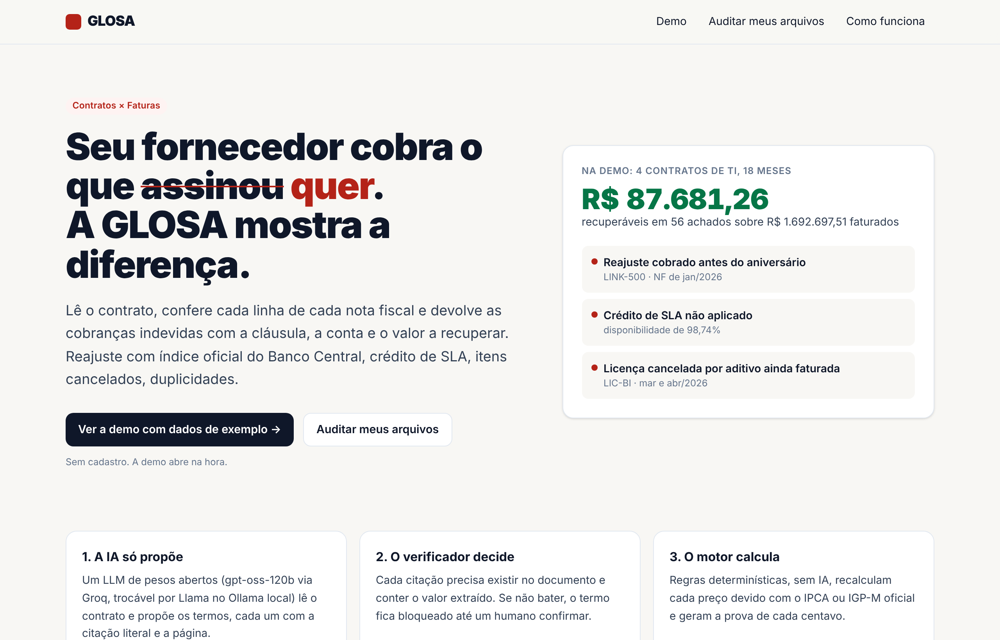
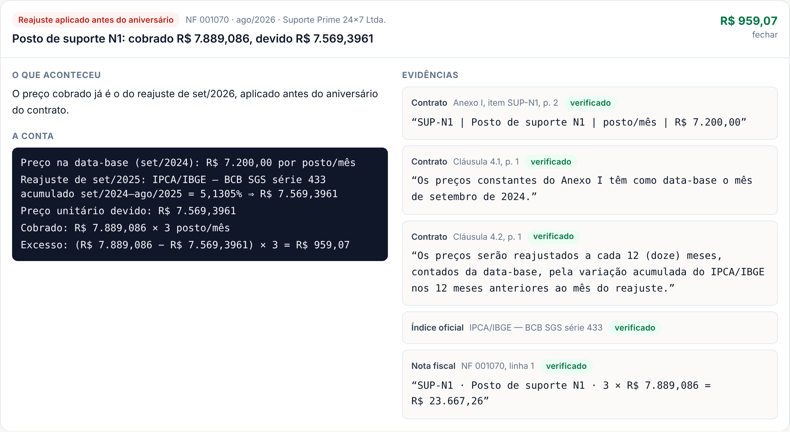
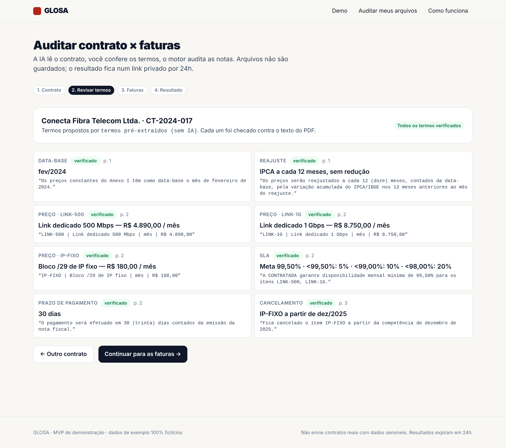
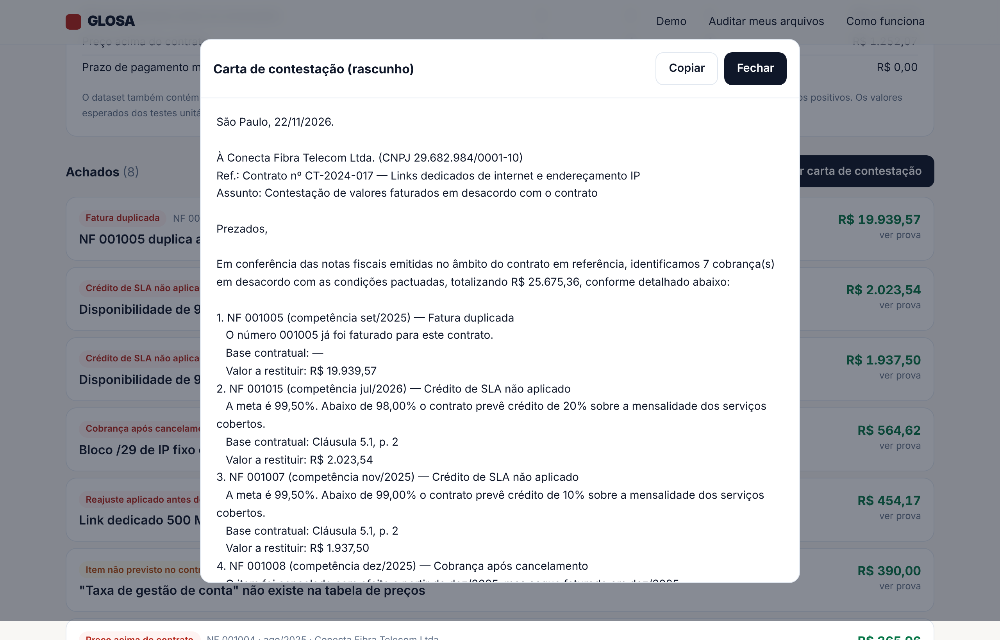

# GLOSA: auditor de contratos × faturas com IA verificável

> Seu fornecedor cobra o que ~~assinou~~ quer. A GLOSA mostra a diferença.

### ▶ [Abrir a demo ao vivo](https://glosa-4tap.onrender.com/demo)
Sem cadastro, com dados 100% fictícios. Está no plano gratuito, então o primeiro acesso pode levar cerca de 50 s para o servidor acordar.



A GLOSA lê um contrato de prestação de serviços em PDF, confere **cada linha de cada nota fiscal** e devolve as cobranças indevidas. Cada achado vem com **a cláusula, a conta e o valor a recuperar**, e todos se juntam numa carta de contestação pronta para enviar ao fornecedor.

Na demo (4 contratos de TI, 75 notas, 18 meses), ela encontra **R$ 87.681,26 recuperáveis**, ou **5,18% do valor faturado**.

---

## O problema

Contas a pagar confere se a nota "bate com o pedido". O vazamento está em outro lugar:

- o reajuste foi aplicado antes do aniversário do contrato;
- o fornecedor usou o índice cheio e ignorou o teto contratual;
- o SLA estourou e o crédito nunca apareceu na fatura;
- um item cancelado por aditivo continua sendo faturado;
- a mesma nota foi cobrada duas vezes.

Consultorias de *contract compliance* fazem isso por amostragem e cobram caro. A GLOSA faz em 100% das notas, em segundos, com prova.

## Cada centavo tem prova



O preço devido é recalculado com o **IPCA/IGP-M oficial do Banco Central** (séries SGS 433 e 189). Cada evidência mostra o trecho literal do contrato, a linha da nota e o índice usado.

## Arquitetura: a IA lê, mas não decide

```
PDF do contrato ──► texto por página
                       │
                       ▼
          LLM de pesos abertos (gpt-oss-120b via Groq · ou Llama no Ollama local)
          propõe os termos + citação literal + página
                       │
                       ▼
   VERIFICADOR (código, sem IA)
   a citação existe no PDF? o valor está no lugar certo dela?
            ┌──────────┴───────────┐
         OBSERVED               INFERRED ──► humano corrige/confirma ──► CONFIRMED
            └──────────┬───────────┘
                       ▼
     MOTOR DETERMINÍSTICO  ◄── faturas (CSV) + medições de SLA (CSV)
     9 regras · índices oficiais versionados · mesma entrada ⇒ mesma saída
                       │
                       ▼
     Achados com conta + evidências ──► carta de contestação
     Link privado (expira em 24h)
```

| Decisão | Por quê |
|---|---|
| **LLM só na borda** | A IA extrai os termos. Nenhum cálculo de dinheiro passa por ela. |
| **Verificador de citações** | Um termo só vira `OBSERVED` se a citação existir literalmente no PDF **e** o valor estiver no lugar certo dela: o preço logo após o "R$" da linha do SKU, a periodicidade como "N meses", o teto como "limitada a X%". Também detecta teto ou cláusula de variação negativa que a IA deixou de extrair. |
| **Fail-closed** | Com qualquer termo não verificado, o motor se recusa a auditar até um humano corrigir ou confirmar. |
| **Nunca extrapola** | Índice ainda não publicado vira aviso, não achado. |
| **Provedor de IA trocável** | Groq, Ollama, OpenAI ou OpenRouter, por variável de ambiente. Com Ollama, **nenhum contrato sai da empresa**, e isso é argumento de venda para jurídico e financeiro. |



## Resultados medidos

**Extração por IA em produção** (gpt-oss-120b via Groq, 3 a 7 s por contrato): **29 de 29 termos** dos 4 PDFs de exemplo extraídos corretamente e com citação verificada. A auditoria feita a partir dos termos extraídos pela IA bateu **centavo por centavo** com o gabarito.

**Motor contra um gabarito sintético.** O dataset tem 56 erros plantados com valor conhecido e armadilhas legítimas: reajustes corretos, IGP-M negativo com cláusula de não redução, créditos de SLA já aplicados.

| Regra | Plantados | Achados | Acertos | R$ plantado |
|---|---:|---:|---:|---:|
| Fatura duplicada | 3 | 3 | 3 | R$ 68.446,31 |
| Crédito de SLA não aplicado | 3 | 3 | 3 | R$ 5.468,64 |
| Cobrança após cancelamento | 3 | 3 | 3 | R$ 4.457,24 |
| Reajuste acima do teto | 35 | 35 | 35 | R$ 3.323,25 |
| Erro aritmético | 2 | 2 | 2 | R$ 1.680,50 |
| Item não contratado | 2 | 2 | 2 | R$ 1.640,00 |
| Reajuste antes do aniversário | 2 | 2 | 2 | R$ 1.413,24 |
| Preço acima do contrato | 4 | 4 | 4 | R$ 1.252,07 |
| Prazo de pagamento inferior | 2 | 2 | 2 | R$ 0,00 |
| **Total** | **56** | **56** | **56** | **R$ 87.681,25** |

Precisão 100% e cobertura 100%. A diferença de R$ 0,01 entre o encontrado e o plantado vem do arredondamento por linha.

**Limites, com honestidade:**
- A avaliação sintética prova que cada regra dispara nos erros plantados e não dispara nas armadilhas.
- A convenção de reajuste (janela do índice, aniversário, arredondamento) é validada à parte, por testes com valores calculados fora do código (Python/Decimal).
- Combinações de erros são cobertas por testes de regressão específicos.

**Auditoria independente.** Antes da publicação, um agente revisor que não escreveu o código procurou defeitos. Os 3 problemas graves que ele achou foram corrigidos e ganharam testes de regressão:
- nota reemitida com o mesmo número escapando da regra de duplicidade;
- o verificador aceitando valores alucinados;
- crédito de SLA cobrado em dobro.

Ao todo, são **44 testes automatizados** e CI no GitHub Actions.



## As 9 regras

| Regra | O que detecta |
|---|---|
| Preço acima do contrato | Preço cobrado > preço-base × reajustes devidos até a competência |
| Reajuste antecipado | Preço cobrado igual ao do **próximo** aniversário do contrato |
| Reajuste acima do teto | Preço cobrado com o índice cheio, ignorando o teto |
| Crédito de SLA não aplicado | Disponibilidade abaixo da meta ⇒ crédito pela faixa contratual, conferido na fatura seguinte |
| Cobrança após cancelamento | Item cancelado por aditivo ainda faturado |
| Item não contratado | Linha sem correspondência na tabela de preços |
| Fatura duplicada | Mesmo número, ou mesma competência + itens + total com outra numeração |
| Erro aritmético | Quantidade × preço ≠ total; soma das linhas ≠ total da nota |
| Prazo de pagamento inferior | Vencimento antes do prazo contratual |

## Teste você mesmo

Na pasta [`samples/`](samples/) estão os 4 contratos fictícios em PDF e as faturas e medições de SLA em CSV. Para testar:
1. Abra [/auditar](https://glosa-4tap.onrender.com/auditar) e envie um dos PDFs.
2. Revise os termos que a IA extraiu.
3. Envie o CSV de faturas.
4. Altere um preço no CSV e veja o achado aparecer.

## Stack

Next.js 16 · TypeScript estrito · Tailwind 4 · Zod · unpdf · Supabase (Postgres, RPC `SECURITY DEFINER` protegido por token, pg_cron) · Groq / Ollama · Vitest · GitHub Actions · Docker · Render

## Sobre este repositório

Esta é a **vitrine pública** do projeto. O código-fonte completo, com o motor de regras, o verificador, os prompts e as integrações, fica em repositório privado, porque a GLOSA é um produto comercial. Em [`excerpts/`](excerpts/) há trechos reais do código: o modelo de domínio e o cálculo de reajuste com índices oficiais.

Avaliações técnicas e acesso ao código completo podem ser combinados diretamente comigo.

---

**Bruno Aragão** · construído com orquestração de agentes de IA (Claude) sob minha definição de escopo, arquitetura e critérios de aceite.

© 2026 Bruno Aragão. Todos os direitos reservados.
